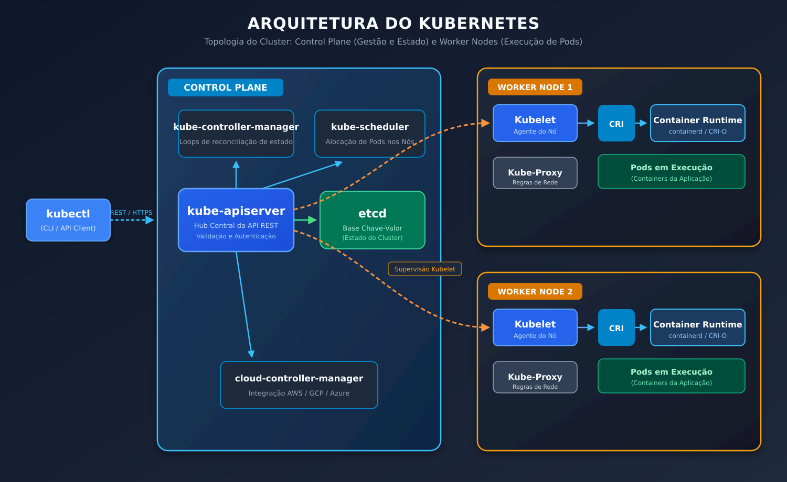
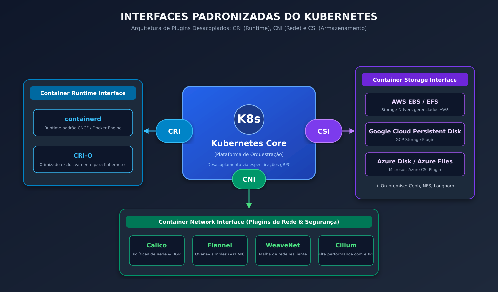
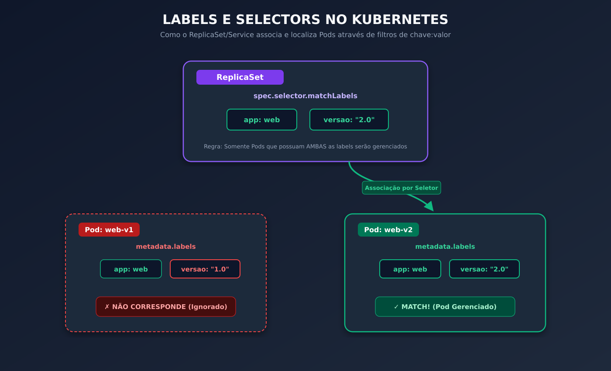
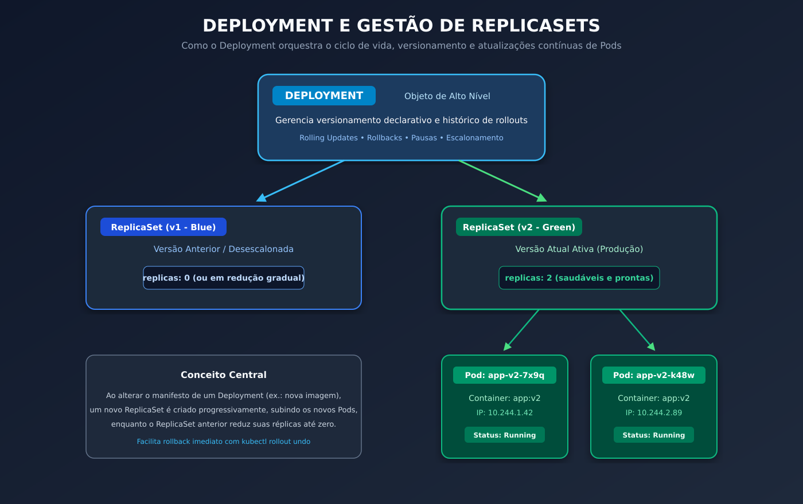
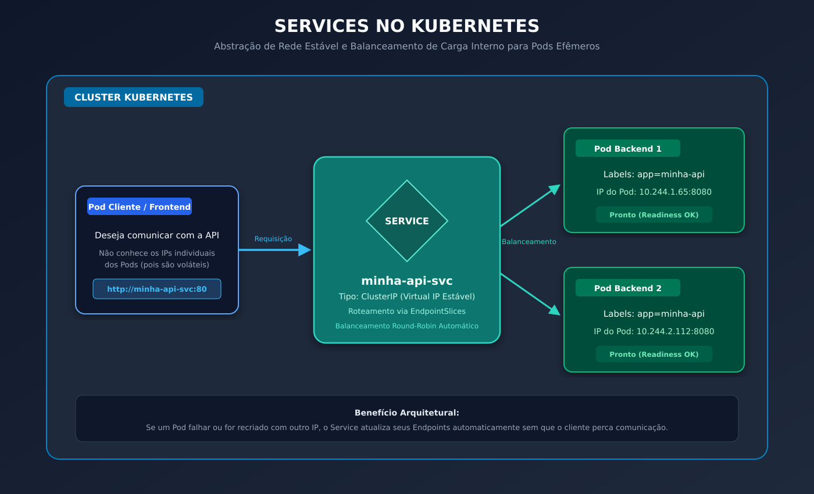
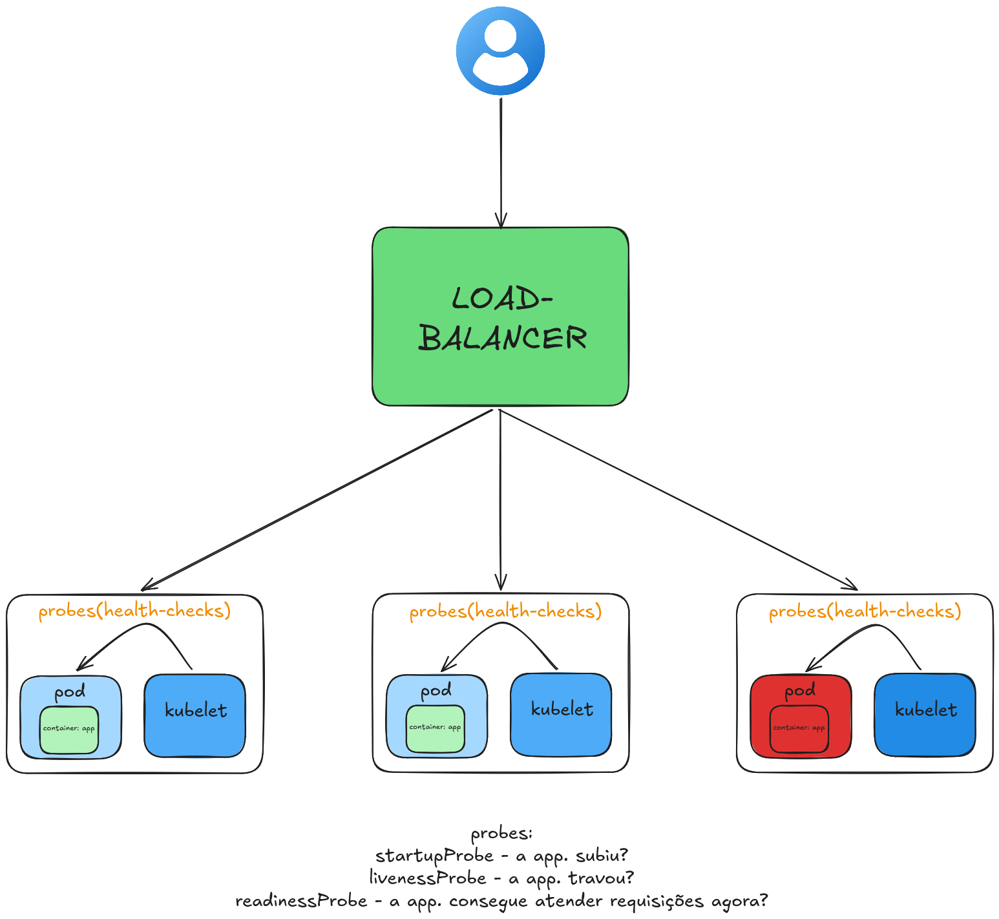
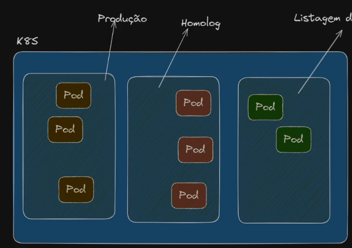

# Galeria de Diagramas e Arquiteturas: Kubernetes

Índice visual com todos os esquemas conceituais e diagramas de estudo utilizados nas anotações.

---

### 1. Arquitetura do Cluster (Control Plane & Worker Nodes)
Visão geral dos componentes centrais do Kubernetes (API Server, Controller Manager, Scheduler, etcd, Kubelet e Kube-proxy).

---

### 2. Interfaces do Kubernetes (CRI, CNI e CSI)
Padrões de integração com motores de container (CRI), plugins de rede (CNI) e drivers de armazenamento (CSI).

---

### 3. Labels e Selectors
Associação dinâmica entre ReplicaSets, Services e Pods através de filtros de rótulos.

---

### 4. Deployments e ReplicaSets
Estratégia de gerenciamento, versionamento e escalabilidade de Pods.

---

### 5. Services e Roteamento de Tráfego
Balanceamento interno e abstração de rede para comunicação estável entre Pods.

---

### 6. Probes e Ciclo de Saúde (Health Checks)
Fluxo do Load Balancer e responsabilidades de cada sonda (`startupProbe`, `livenessProbe`, `readinessProbe`).

---

### 7. Namespaces e Isolamento de Ambientes
Divisão lógica de recursos no cluster entre produção, homologação e projetos.

